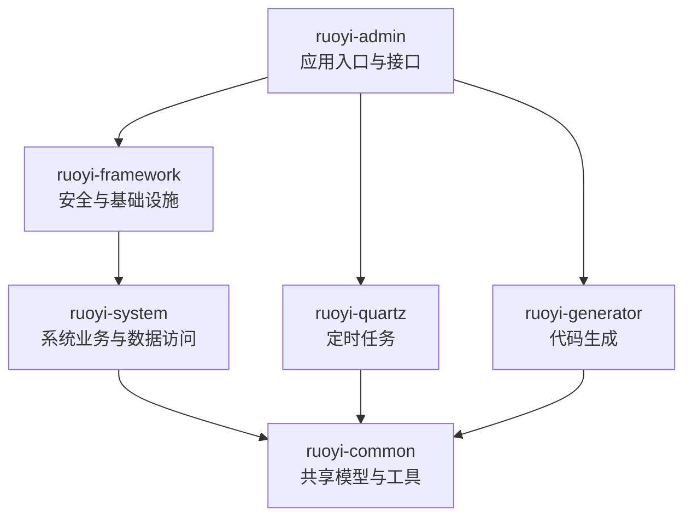

# 阶段 1：项目全景与目录结构

## 一句话总结

这是 **若依 RuoYi-Vue 3.9.2 的 Java 后端管理平台**，提供用户、角色、部门、菜单、日志、定时任务和代码生成等后台能力。README 将项目定位为可供个人和企业使用的快速开发平台；**目标用户是需要搭建或二次开发管理后台的开发者和团队**，这是基于项目定位与功能作出的受众判断。依据：`README.md:4-20, 46-65`。

## 技术栈透视

| 领域 | 仓库中的实现 | 用途与依据 |
|---|---|---|
| 语言与构建 | Java 17、Maven 多模块 | 根 `pom.xml:15-21, 176-184` 设置 Java 版本并列出六个模块。 |
| Web 与安全 | Spring Boot 4.1.0、Spring MVC、Spring Security、JWT | 后端通过 REST Controller 提供接口；`SecurityConfig` 配置安全过滤链，`JwtAuthenticationTokenFilter` 处理 JWT。版本见 `pom.xml:19-21`。 |
| 数据访问 | MySQL、Druid、MyBatis XML、PageHelper | 默认数据源 URL 指向 MySQL，使用 Druid；MyBatis 扫描 Mapper XML，并配置 MySQL 分页。见 `ruoyi-admin/src/main/resources/application-druid.yml:1-15`、`application.yml:104-117`。 |
| 缓存 | Redis | 配置 Redis 连接，`ruoyi-common/pom.xml:92-101` 声明 Redis 依赖；共享缓存入口包括 `RedisCache`。 |
| 扩展能力 | Quartz、Velocity、Springdoc、Apache POI | 分别用于定时任务、模板代码生成、API 文档和 Excel 功能；依赖见 `ruoyi-quartz/pom.xml`、`ruoyi-generator/pom.xml`、`ruoyi-admin/pom.xml` 与根 `pom.xml`。 |
| 打包与运行 | Maven；Spring Boot 可执行 JAR | `ruoyi-admin/pom.xml:11, 59-73` 声明 JAR 与 repackage；`bin/run.bat:6-11` 以 `java -jar` 启动。 |
| 测试 | 当前检出未发现 `src/test` 或测试类 | `bin/package.bat:10` 的打包命令也显式跳过测试。 |

README 介绍了 Vue 前端，但当前仓库实际没有前端应用目录、`package.json` 或 `.vue` 源文件；README 将 Vue 2、Vue 3 等前端项目列为独立仓库（`README.md:33-44`）。本仓库包含的是代码生成器模板，例如 `ruoyi-generator/src/main/resources/vm/` 下的 Vue、JS、TS、Java、XML 和 SQL 模板。技术选型的具体动机没有在文档中逐项说明，因此这里只说明可从配置和源码验证的用途，不将常见选型理由当作项目事实。

## 目录结构与职责边界

| 目录 | 职责 |
|---|---|
| `ruoyi-admin` | 应用入口和 HTTP 接口层。`RuoYiApplication.main` 启动 Spring Boot；`web/controller` 下有系统、监控、通用等控制器。例如 `SysUserController` 定义 `/system/user` 接口。见 `RuoYiApplication.java:12-18`、`SysUserController.java:40-42`。 |
| `ruoyi-framework` | 安全、配置和横切基础设施，包括 JWT、安全配置、过滤器、数据权限与日志等。代表性实现有 `SecurityConfig`、`DataScopeAspect`。 |
| `ruoyi-system` | 系统管理业务的 Service、Mapper 和 MyBatis XML。比如 `SysUserServiceImpl` 使用用户和角色相关 Mapper；SQL 映射位于 `src/main/resources/mapper/system/`。 |
| `ruoyi-quartz` | 定时任务相关接口、服务、调度工具和 Mapper，例如 `SysJobController`、`ScheduleUtils`。 |
| `ruoyi-generator` | 代码生成接口、服务及 Velocity 模板；`GenController` 提供生成器接口，模板覆盖 Java、XML、SQL 和多种前端输出。 |
| `ruoyi-common` | 被多个模块复用的实体、注解、响应对象、分页、异常和工具类。部分系统实体（如 `SysUser`、`SysRole`）也放在这里，而不是全部归入 `ruoyi-system`。 |
| `sql`、`bin`、`doc` | 数据库初始化脚本、打包/运行脚本和使用手册；例如 `sql/ry_20260417.sql`、`sql/quartz.sql`。 |

## 模块依赖关系

下图表示 **Maven 模块的直接依赖**，不是完整的运行时调用时序。根 `pom.xml:176-184` 列出六个模块；各模块 POM 声明的依赖关系如下：`ruoyi-admin` 依赖 framework、quartz 和 generator；framework 依赖 system；system、quartz、generator 依赖 common。

**整体理解：** 这是一个以 `ruoyi-admin` 作为应用装配入口、按系统业务和基础能力拆分的后端 Maven 工程，不是包含 Vue 页面的一体化前后端仓库。