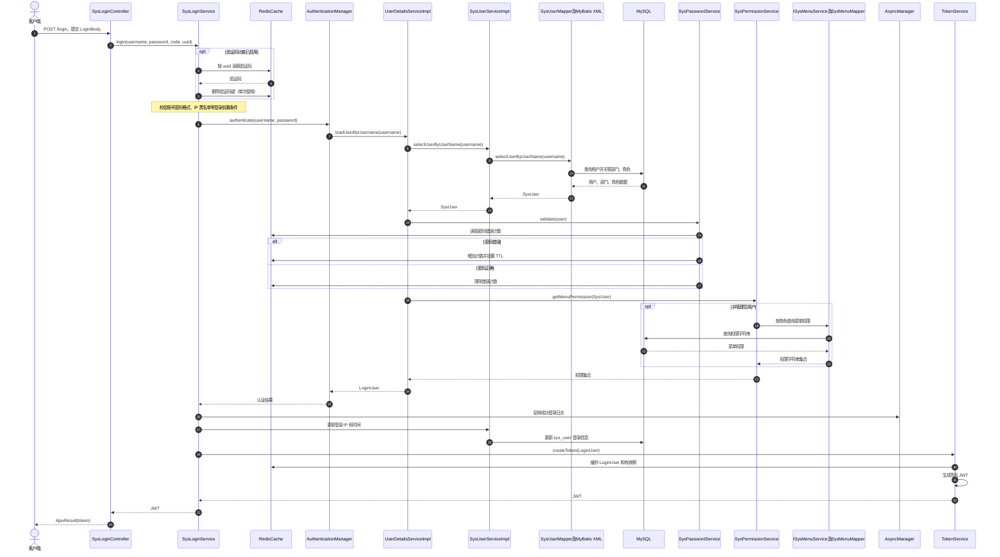
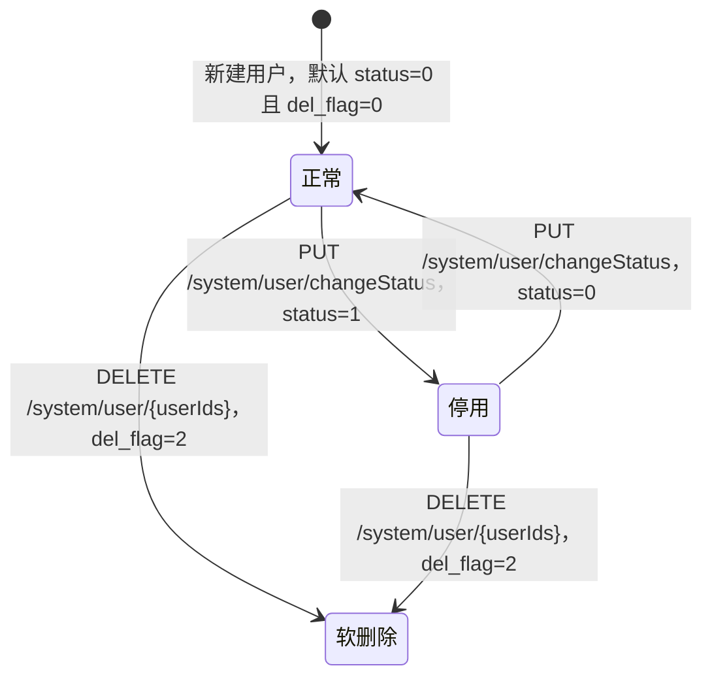

# 阶段 2：核心概念与数据流转

## 1. 核心概念

- **`SysUser`：持久化的用户资料。** 对应 `sys_user`，包含账号、密码、部门、状态等字段；对象上还挂有 `dept`、`roles`，并有 `roleIds`、`postIds` 供用户管理操作传递关联信息。定义见 `ruoyi-common/src/main/java/com/ruoyi/common/core/domain/entity/SysUser.java:23-94`。
- **`SysRole` 与 `SysMenu`：权限配置的两端。** 角色持有权限标识、数据范围和菜单 ID 等信息（`SysRole.java:18-65`）；菜单记录目录、路由、组件和权限字符串，也区分目录、菜单、按钮（`SysMenu.java:17-70`）。用户与角色、角色与菜单的关系通过关联表表达。
- **`LoginBody`：登录请求 DTO。** 承载用户名、密码、验证码和验证码 UUID，见 `ruoyi-common/src/main/java/com/ruoyi/common/core/domain/model/LoginBody.java:8-28`。
- **`LoginUser`：运行期的安全主体。** 它实现 Spring Security 的 `UserDetails`，封装用户、部门、权限、登录时间和 token 等信息；`getAuthorities()` 将权限字符串转换为 Spring Security authorities。见 `LoginUser.java:19-94, 265-277`。它不只是数据库用户实体，而是登录后用于认证和授权的上下文。
- **其他功能模块的模型：** `SysJob` 保存任务目标、Cron 表达式和任务状态（`ruoyi-quartz/.../SysJob.java:21-55`）；`GenTable` 保存代码生成所需的表、列、模板和包路径配置（`ruoyi-generator/.../GenTable.java:16-84`）。

## 2. 核心链路一：登录、发令牌与后续请求认证

### 登录请求如何变成 token

1. `SysLoginController.login` 接收 `LoginBody`，调用 `SysLoginService.login`，成功后把 token 放进 `AjaxResult` 返回（`ruoyi-admin/src/main/java/com/ruoyi/web/controller/system/SysLoginController.java:56-65`）。
2. `SysLoginService.login` 先校验验证码和登录前置条件：验证码启用时从 Redis 取出后即删除，再比对；前置检查用户名、密码长度和 IP 黑名单（`ruoyi-framework/src/main/java/com/ruoyi/framework/web/service/SysLoginService.java:63-68, 110-165`）。
3. 随后调用 `AuthenticationManager.authenticate`。实际加载用户的入口是 `UserDetailsServiceImpl.loadUserByUsername`：它通过 `ISysUserService.selectUserByUserName` 查用户，并检查用户是否存在、已删除或已停用（`SysLoginService.java:73-76`；`UserDetailsServiceImpl.java:38-59`）。
4. 查询实现落到 `SysUserMapper` 与 MyBatis XML。`selectUserByUserName` 复用的 SQL 会关联部门、用户角色和角色表，结果映射为带部门、角色信息的 `SysUser`（`SysUserServiceImpl.java:114-118`；`SysUserMapper.xml:50-58, 124-127`）。
5. `SysPasswordService.validate` 从 Redis 读取密码错误计数；密码错误时增加带过期时间的计数，密码正确则清除计数。用户通过检查后，`SysPermissionService.getMenuPermission` 收集菜单权限，并构造 `LoginUser`（`SysPasswordService.java:44-85`；`UserDetailsServiceImpl.java:57-65`；`SysPermissionService.java:58-88`）。
6. 认证成功后，`SysLoginService` 异步安排登录日志，更新用户的登录 IP 和时间，然后调用 `TokenService.createToken`。后者生成 UUID、将 `LoginUser` 按有效期写入 Redis，再生成签名 JWT 返回（`SysLoginService.java:95-99, 172-175`；`TokenService.java:115-125, 149-156`）。

### 登录时序图

### 后续请求如何恢复身份

后续请求由 `JwtAuthenticationTokenFilter.doFilterInternal` 读取 token、取回 Redis 中的 `LoginUser`，必要时刷新有效期，再放入 Spring Security `SecurityContext`（`JwtAuthenticationTokenFilter.java:31-43`；`TokenService.java:63-83, 134-156`）。登录后的 `getInfo` 返回用户、角色和权限；`getRouters` 通过 `selectMenuTreeByUserId` 查询菜单并构建前端路由（`SysLoginController.java:72-106`；`SysMenuServiceImpl.java:139-150, 172-221`）。非管理员的菜单查询通过用户—角色—菜单关联筛选正常状态的菜单和角色（`SysMenuMapper.xml:77-85`）。

这里需要区分两层状态：`SecurityConfig` 将 Spring Security 配为无 HTTP Session 模式；但 token 对应的 `LoginUser` 存在 Redis 中。因此它不是“服务端完全无状态”：后续请求仍需通过 JWT 中的标识去 Redis 取登录上下文（`SecurityConfig.java:97-108`；`TokenService.java:63-83`）。

## 3. 核心链路二：新增后台用户

`POST /system/user` 接收一个 `SysUser`，但其输入不只对应 `sys_user` 一行：

1. `SysUserController.add` 要求 `system:user:add` 权限，并检查部门和角色的数据范围；接着检查用户名唯一性，以及非空手机号、邮箱的唯一性。通过后记录创建人、加密密码，再调用 `insertUser`（`ruoyi-admin/src/main/java/com/ruoyi/web/controller/system/SysUserController.java:122-144`）。
2. `SysUserServiceImpl.insertUser` 标记为 `@Transactional`：先插入用户主记录，MyBatis 通过 `useGeneratedKeys` 回填 `userId`；再根据 `postIds`、`roleIds` 生成用户—岗位和用户—角色关联记录（`ruoyi-system/src/main/java/com/ruoyi/system/service/impl/SysUserServiceImpl.java:260-270, 401-449`；`SysUserMapper.xml:146-178`）。
3. 关联记录由 Mapper 批量写入 `sys_user_post` 和 `sys_user_role`（`SysUserPostMapper.xml:27-32`；`SysUserRoleMapper.xml:27-32`）。整个 Service 方法处于事务边界内，成功时返回主表写入结果，再由 Controller 包装响应。

## 4. 用户状态流转

用户有两个独立字段：`status` 表示正常/停用，`del_flag` 表示存在/删除。初始化 SQL 中两者默认值分别为 `0`；删除操作则将 `del_flag` 更新为 `2`，属于软删除，并非物理删除（`sql/ry_20260417.sql:42-64`）。

状态变更由 `SysUserController.changeStatus` 调用 Service，最终执行 `update sys_user set status = ...`（`SysUserController.java:204-215`；`SysUserMapper.xml:200-202`）。删除路径会清理用户与角色、岗位的关联，再将 `del_flag` 设为 `2`；用户列表及用户名登录查询都筛选 `del_flag = '0'`（`SysUserServiceImpl.java:475-488`；`SysUserMapper.xml:63, 124-127, 216-225`）。